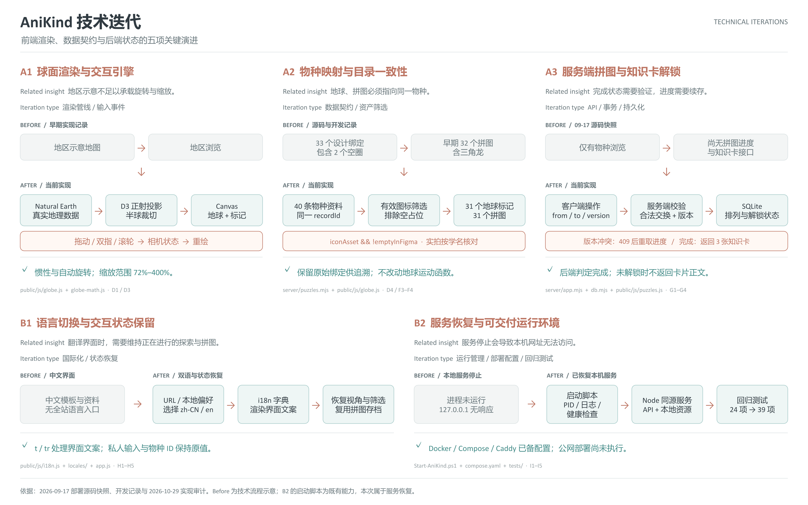

# AniKind 迭代索引

本仓库收录可核对的历史源码快照、当前前后端实现与 45 项迭代说明。2026-10-30 整理上传；Git 提交日期是归档时间，不是功能最初编写时间。

## 历史源码

| 标签 | 内容 | 证据 |
| --- | --- | --- |
| `snapshot-2026-09-17` | 纪念空间、物种档案、交互地球、本地服务和部署配置 | 原始 `anikind-singapore-20260917-161121.zip`；另补忽略运行数据的 `.gitignore` |
| `snapshot-2026-10-29` | 空圈清理、真实照片拼图、后端进度与知识卡、中英切换 | 10 月 29 日实现完成后的工作区源码 |
| `main` | 当前实现及归档文档、关系图、历史启动工具 | 在第二份快照上补充可移植的交付文件 |

没有 9 月 18 日、9 月 25 日的完整中间源码，因此不人为拆分成这些日期的提交。两个 9 月 17 日部署包网页代码一致，仅文档与打包脚本不同。

## 迭代材料

- [45 项完整说明与代码定位](完整迭代清单.md)
- [源码文件清单](源码文件清单.csv) / [公开资产清单](公开资产清单.csv)
- [规范化源码差异](20260917-20261029源码差异.patch)：供阅读追溯，不建议直接应用到当前项目
- [结构化内容](迭代内容.json)
- [13 页 PDF 图册](AniKind-前后端迭代图册.pdf) / [可编辑 PPTX](AniKind-前后端迭代图册.pptx)
- [技术迭代图](technical.png) / [技术迭代可编辑稿](technical.pptx)
- [硬件与终端关系图](hardware.png) / [硬件关系可编辑稿](hardware.pptx)
- [图表源代码](../../tools/diagrams/README.md)
- [历史网站启动说明](../../tools/history/README.md)

## 上传前验证

在独立的仓库目录运行 `node scripts/check.mjs` 和 `node --test --test-concurrency=1 tests/*.test.mjs`：语法检查通过，39 项测试全部通过。测试不使用正在运行的网站数据库。

公开仓库不包含 `.env`、私人数据库、上传的私人素材、会话令牌、日志或运行期导出文件。第三方公开资产保留原有许可与来源记录。没有对项目额外授予统一开源许可证。

界面适配与双指操作代码已实现；真机、容器、真实 AI 与公网部署仍需单独验收。硬件图展示终端和运行环境关系，没有实体传感器或执行器的升级。
